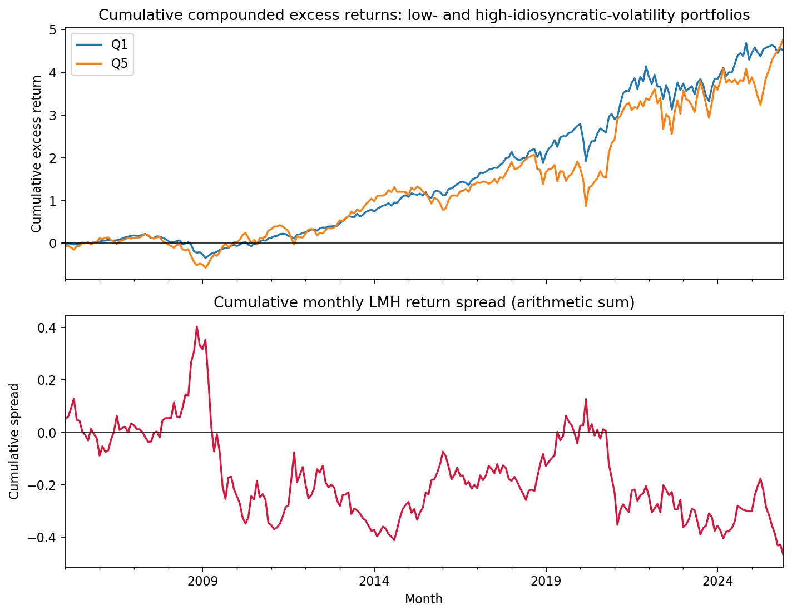

# Project 2: Does low idiosyncratic volatility earn a premium?

*Report draft — verify the tables after a clean notebook run and format to the four-page limit.*

## Question and factor

This project tests whether low-idiosyncratic-volatility stocks outperform high-volatility stocks after accounting for market exposure. The audience is a quantitative portfolio manager considering a low-volatility tilt. The factor is an equal-weighted long-short portfolio, `LMH = Q1 - Q5`, where stocks are sorted each month into five groups using idiosyncratic volatility estimated through the previous month. Idiosyncratic volatility is the residual standard deviation from a trailing 60-month CAPM regression (at least 36 valid observations). The one-month lag avoids look-ahead bias.

The behavioral interpretation is that investors may overpay for high-volatility "lottery-like" stocks or face constraints that make low-volatility stocks attractive. A rational-risk interpretation is also possible: the strategy may hedge bad states and therefore have a different expected return. The evidence below does not establish a reliable positive premium for LMH.

## Data and methods

The supplied files contain monthly S&P 500 stock total returns, market returns, and one-month risk-free rates from 2000 through 2025. Returns are in decimal units. Stock excess return is `total_return - RF`; the market factor is `market_return - RF`. The notebook does not recompute returns from the supplied price field. No delisting-return series or market capitalization is supplied, so delisting adjustments and value weighting are unavailable.

The panel has 156,560 input stock-month rows. The cleaning checks removed zero duplicate PERMNO/month rows and five rows with missing total returns. Monthly 1st/99th percentile diagnostics flagged 3,394 raw return values; these are retained in the raw analysis. The added winsorized test clips 3,394 return values and 2,530 idiosyncratic-volatility characteristics at monthly 1st/99th percentiles. Missing returns are never set to zero.

The notebook reports three complementary analyses: (1) a time-series CAPM regression of LMH on the market excess return, with Newey-West standard errors using six lags; (2) stock-by-stock regressions on MKT and LMH, with descriptive counts of significant stock betas; and (3) two-pass Fama-MacBeth regressions, using trailing first-pass betas and Newey-West errors on monthly second-pass slopes. The Fama-MacBeth sample has 192 cross-sections from 2010–2025 because the first-pass estimates require historical factor observations. Its risk premium is not the same estimand as the time-series portfolio alpha.

## Main results

| Time-series test | LMH estimate per month | HAC t-stat / p-value | R² / sample |
|---|---:|---:|---|
| Raw LMH CAPM alpha | 0.321% | t = 1.37, p = 0.172 | R² = 0.363; 252 months |
| Raw LMH market beta | -0.620 | t = -8.87 | Same CAPM regression |

| Fama-MacBeth specification | MKT premium (p-value) | LMH premium (p-value) | Avg. R² | Avg. adjusted R² |
|---|---:|---:|---:|---:|
| MKT only | 0.243% (0.351) | — | 0.0645 | 0.0624 |
| LMH only | — | -0.137% (0.553) | 0.0696 | 0.0674 |
| MKT + LMH | 0.286% (0.259) | -0.090% (0.691) | 0.0871 | 0.0830 |

All Fama-MacBeth specifications use 192 cross-sections and about 442 stocks per month. The LMH-only second-pass regression also estimates an intercept (alpha): 0.899% per month (HAC t = 4.94, p < 0.001; 95% CI 0.543% to 1.256%). This is the average cross-sectional return not explained by estimated LMH exposure, not the LMH portfolio's time-series CAPM alpha. Its significance does not imply that LMH exposure itself is priced: the LMH premium remains insignificant (p = 0.553). HAC t-statistics are -0.40 for the joint LMH premium and 1.13 for the joint MKT premium.

The raw LMH portfolio's mean monthly excess return is -0.186%. Its positive CAPM alpha is not statistically significant. In the individual-stock regressions, 300 of 785 eligible stocks (38.2%) have a significant LMH beta at 5%, compared with 738 (94.0%) for MKT. These are unadjusted, descriptive tests and do not establish a cross-sectional price of risk. The full-sample MKT-LMH correlation is about -0.60 (VIF about 1.57).

The joint model's average adjusted cross-sectional R² is higher than the MKT-only model's (0.0830 versus 0.0624), but the LMH premium remains insignificant (p = 0.691). LMH improves sample fit in this comparison without providing evidence that its exposure earns a nonzero premium.

### Market risk-price robustness

The Fama-MacBeth market coefficient is the cross-sectional **price of estimated market-beta exposure**, not an individual stock's time-series market beta. Its estimate is positive in every reported specification, but the p-value is not low in the 60-month baseline.

| Cross-sectional model | Beta window; minimum observations | HAC lags | MKT price per month | p-value |
|---|---:|---:|---:|---:|
| MKT only | 60 months; 36 | 6 | 0.243% | 0.351 |
| MKT + LMH | 60 months; 36 | 6 | 0.286% | 0.259 |
| MKT only | 36 months; 24 | 6 | 0.429% | 0.119 |
| MKT + LMH | 36 months; 24 | 6 | 0.450% | 0.096 |

For the fixed 60-month models, varying Newey-West lags from 0 to 12 leaves the MKT-price p-value between 0.253 and 0.277 in the joint model, and 0.345 to 0.422 in the MKT-only model. This is not a result that becomes significant by selecting a different HAC lag. A separate test of the realized market excess-return mean is significant (1.084% monthly; p < 0.001), but that is a time-series average, not the Fama-MacBeth cross-sectional price of beta. It cannot be substituted for the nonsignificant Fama-MacBeth test. The 36-month alternative is suggestive but changes both the estimation window and minimum-history rule, and remains insignificant at 5%.

The upper panel shows Q1 finishing above Q5 in cumulative compounded excess returns, while the lower panel shows the running arithmetic sum of monthly LMH returns remaining negative near the end of the sample. These paths describe historical performance; the CAPM alpha and Fama-MacBeth tests above determine whether the apparent differences are statistically reliable after controls.

## Sensitivity and bad-times evidence

| Specification | Mean LMH premium/alpha per month | p-value | Months |
|---|---:|---:|---:|
| Raw portfolio CAPM alpha | 0.321% | 0.172 | 252 |
| Winsorized portfolio CAPM alpha | 0.451% | 0.039 | 252 |
| Raw joint Fama-MacBeth LMH premium | -0.090% | 0.691 | 192 |
| Winsorized-return Fama-MacBeth LMH premium | -0.034% | 0.877 | 192 |
| Crisis-only joint Fama-MacBeth LMH premium | 0.254% | 0.800 | 21 |

The winsorized portfolio CAPM alpha becomes significant while the raw alpha does not, so the time-series alpha result is sensitive to outlier treatment. The Fama-MacBeth risk premium remains insignificant in the raw, winsorized-dependent-return, and crisis-only tests. In the winsorized Fama-MacBeth check, first-pass betas are held fixed to isolate the effect of clipping second-pass returns. The earlier raw-return test was the same as the raw baseline; the new winsorized result provides the actual comparison.

LMH averages +2.52% in down-market months and -1.69% in up-market months; the HAC mean difference is +4.21% (p < 0.001). In the 22 portfolio-return months within the specified recession/COVID windows, LMH averages -0.35%, versus -0.17% in other months; the HAC difference is not significant (p = 0.925). The down/up pattern suggests state-dependent hedging behavior, but it is not evidence of a reliable unconditional premium. The crisis estimate is especially uncertain because its Fama-MacBeth sample contains only 21 months.

## Interpretation and conclusion

The portfolio can perform differently in down and up markets, which is consistent with its having state-dependent hedging properties. However, neither the raw portfolio CAPM alpha nor the Fama-MacBeth LMH premium is significant, and the only significant portfolio alpha appears after winsorization. These results do not clearly distinguish rational risk compensation from behavioral mispricing. The evidence is too sensitive and imprecise to claim a robust anomaly.

Because the signal uses public historical returns, the question is relevant to weak-form market efficiency. The insignificant raw Fama-MacBeth premium is not evidence against weak-form efficiency, but it also does not prove that markets are efficient. Trading costs, turnover, and implementable portfolio constraints are not estimated here. For a manager, the current results do not justify relying on an LMH premium after costs.

The benchmark is CAPM only. SMB/HML/UMD factor returns are not included in the supplied data, so the project has not shown that LMH adds explanatory power beyond a Fama-French/Carhart benchmark. The S&P 500-only universe, possible survivorship bias, missing delisting returns, equal weighting, and unadjusted individual-stock significance tests are further limitations.

**References:** Ang, Hodrick, Xing, and Zhang (2006), “The Cross-Section of Volatility and Expected Returns”; Grossman and Stiglitz (1980), “On the Impossibility of Informationally Efficient Markets.”
